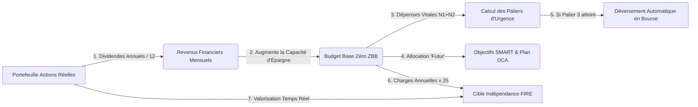

# PLAN DIRECTEUR D'AMÉLIORATION & INTÉGRATION D'APIS TEMPS RÉEL
## Dashboard Patrimonial & Budgétaire (`SuiviPatrimoine`)

---

## 1. VISION STRATÉGIQUE & OBJECTIFS

Le projet **SuiviPatrimoine** dispose d'un socle fonctionnel complet (Score de santé à 6 piliers, Budget Base Zéro, strates N1-N4, simulation stochastique Monte Carlo, portefeuille d'actions multi-marchés, backend Google Apps Script).

L'objectif de ce document est de formaliser :
1. **La refonte UI/UX** pour éliminer la surcharge cognitive et offrir une expérience digne des applications fintech modernes (type Finary, Wealthfront, YNAB).
2. **Le système d'interconnexion dynamique** pour créer une boucle de rétroaction complète entre les revenus, les dépenses, l'épargne de précaution, le portefeuille boursier et les simulations d'indépendance financière (FIRE).
3. **Le catalogue d'APIs gratuites / freemium** pour connecter le tableau de bord à des flux de données réelles et en temps réel (banques, bourses occidentales et africaines, cryptos, devises, inflation).
4. **Le guide d'implémentation technique** avec le code prêt à l'emploi pour le frontend et le backend Google Apps Script.

---

## 2. AUDIT & RECOMMANDATIONS UI/UX

```
┌──────────────────────────────────────────────────────────────────────────────────┐
│                             COMMAND CENTER (HEADER)                              │
│ [👁️ Masquer Montants]  [EUR/FCFA/USD/CHF]  [🌐 Sync En Direct]  [Ctrl+K Recherche] │
└──────────────────────────────────────────────────────────────────────────────────┘
         │
         ├── 🧭 1. PILOTAGE (Vue d'ensemble, Sankey Cash-Flow, Budget ZBB, Check-list)
         ├── 🛡️ 2. SÉCURITÉ (Fonds d'Urgence 3 Paliers, Dettes, Contacts d'Urgence)
         ├── 📈 3. INVESTISSEMENT (Patrimoine Net, Bourses BRVM/EU/US, DCA, Monte Carlo, FIRE)
         └── ⚙️ 4. AUTOMATISATIONS & FLUX (Banques en direct, Google Sheets, Règles)
```

### 2.1 Refonte de la Navigation : De 11 Onglets Étroits à 4 Espaces Majeurs
- **Constat :** Les 11 boutons horizontaux saturent la largeur d'écran et forcent un défilement horizontal pénible sur laptop et mobile.
- **Solution :** Regrouper l'interface en **4 macro-espaces** accessibles via une barre latérale élégante (*Sidebar*) sur grand écran et une barre d'onglets inférieure (*Bottom Tab Bar*) sur mobile :
  - **Espace 1 · Pilotage Quotidien :** Synthèse KPIs, diagramme de flux Sankey (Revenus ➔ Charges ➔ Épargne), gestionnaire de Budget Base Zéro (ZBB) et check-list mensuelle.
  - **Espace 2 · Résilience & Sécurité :** Modélisation des 3 paliers d'urgence (48h, Sérénité, Forteresse), calendrier d'extinction des dettes et annuaire chiffré de crise.
  - **Espace 3 · Patrimoine & Investissements :** Bilan patrimonial complet, valorisation d'actions réelles en direct, simulateur multi-marchés (BRVM, Euronext, Wall Street), projection Monte Carlo et jauge FIRE.
  - **Espace 4 · Synchronisation & Règles :** Connexions bancaires, API en direct, Google Apps Script, historique des instantanés et règles d'automatisation.

### 2.2 Nouveaux Composants Interactifs Clés
1. **Diagramme de Flux Interactif (« Cash-Flow Sankey ») :**
   Visualiser graphiquement la trajectoire de chaque euro ou FCFA :
   $$\text{Revenus Bruts} \rightarrow \text{Net Disponible} \rightarrow \begin{cases} \text{Strate Fixe N1/N2 (60\%)} \\ \text{Strate Variable N3/N4 (20\%)} \\ \text{Épargne de Sécurité (10\%)} \\ \text{Investissements Bourse (10\%)} \end{cases}$$
2. **Tiroirs Latéraux (Slide-Over Drawers) en remplacement des Modals :**
   Remplacer les popups centrées qui masquent tout l'écran par des panneaux coulissants depuis la droite. L'utilisateur peut ainsi ajuster une action ou ajouter une dépense tout en observant ses métriques clés se recalculer en arrière-plan.
3. **Mode Discrétion Immédiate (Privacy Eye Toggle) :**
   Un bouton dans le header permettant d'occulter instantanément tous les montants (remplacés par `•••• €` ou `•••• FCFA`) pour une consultation sereine dans les lieux publics.
4. **Command Palette (`Ctrl + K` / `Cmd + K`) :**
   Une fenêtre de recherche instantanée pour naviguer dans n'importe quel poste budgétaire, lancer une synchronisation ou basculer de profil sans quitter le clavier.

---

## 3. INTERCONNEXION EN BOUCLE FERMÉE DES COMPOSANTS

Dans l'état actuel, les bourses, le budget et les objectifs fonctionnent de façon cloisonnée. L'application doit devenir un système vivant où chaque donnée influence les autres en temps réel.



### 3.1 Les 5 Boucles d'Interconnexion à Activer
1. **Boucle Portefeuille ➔ Revenus Passifs :**
   Les dividendes générés par les actions réelles saisies (ex: Sonatel, TotalEnergies, Apple) sont calculés automatiquement et injectés dans la ligne `Revenus Financiers` du budget.
2. **Boucle Dépenses Vitales ➔ Cibles des Paliers d'Urgence :**
   Les seuils des 3 paliers d'urgence (48h = 1 000 €, Sérénité = 1 à 3 mois, Forteresse = 3 à 6 mois) ne doivent plus être des chiffres statiques, mais le produit exact de la somme des strates de survie **N1 (Vital) + N2 (Essentiel incompressible)**.
3. **Boucle Budget Futur ➔ Échéance Réelle des Objectifs SMART :**
   La durée restante estimée pour chaque objectif est recalculée dynamiquement en fonction du montant effectivement alloué ce mois-ci dans l'enveloppe `futur.projets`.
4. **Boucle Dépenses Totales ➔ Nombre FIRE Réel :**
   Le montant requis pour l'indépendance financière ($\text{Dépenses Annuelles} \times 25$) s'adapte immédiatement dès qu'un curseur de dépense est bougé.
5. **Boucle Stress-Test ➔ Bilan Patrimonial Global :**
   L'application d'un scénario de marché (-30% krach ou +18% bull run) recalcule instantanément la valeur nette du patrimoine global et ajuste la date prévisionnelle de retraite FIRE.

---

## 4. CATALOGUE D'APIS TEMPS RÉEL (GRATUITES & FREEMIUM)

Pour donner vie à vos données sans saisie manuelle permanente, voici la sélection des meilleures APIs du marché, testées et adaptées aux besoins du projet :

### 4.1 Agrégation Bancaire & Synchronisation des Comptes (Open Banking)

| API | Couverture | Modèle Tarifaire | Fonctionnalités & Avantages |
| :--- | :--- | :--- | :--- |
| **GoCardless Bank Account Data** *(Ex-Nordigen)* | **France, Europe, UK** *(>2 500 banques : Bourso, BNP, CA, Revolut, SG...)* | **Gratuit (Freemium)** (Jusqu'à plusieurs comptes sans frais pour usage perso) | API officielle conforme DSP2. Récupère les **soldes en direct** et l'**historique des transactions** (90 jours à 2 ans) au format JSON propre. Remplace définitivement la corvée du fichier CSV. |
| **Plaid** | **USA, Canada, UK, Europe** | Clé Développeur gratuite (Sandbox + 100 liaisons live gratuites) | Idéal si vous détenez des comptes bancaires ou de courtage aux États-Unis ou au Royaume-Uni. |
| **Tink (Groupe Visa)** | **Europe entière** | Formule développeur gratuite pour prototypage | Accès unifié aux comptes courants, livrets d'épargne et cartes de crédit. |

---

### 4.2 Cours de Bourse & Portefeuilles Mondiaux (Europe, USA, Asie)

| API | Couverture | Modèle Tarifaire | Données Fournies |
| :--- | :--- | :--- | :--- |
| **Twelve Data** | **Actions US, Euronext, ETF, Crypto, Forex** | **Gratuit** (800 requêtes/jour, 8 req/min) | API REST & WebSockets ultra-rapide. Renvoie le prix actuel (`quote`), la variation du jour, le PER, le rendement de dividende et l'historique chandelier. |
| **Finnhub.io** | **Global (NYSE, Nasdaq, Euronext, LSE)** | **Gratuit** (60 requêtes/minute) | Cours temps réel, profils de sociétés, calendrier des dividendes et métriques financières fondamentales. |
| **Yahoo Finance (via RapidAPI ou proxy)** | **Marchés mondiaux complets (y compris CAC 40, ETF CW8/WPEA)** | **Gratuit** | Accès universel aux tickers mondiaux avec historique complet et consensus d'analystes. |

---

### 4.3 Marchés Africains & Bourses Régionales (BRVM, BVMAC, NGX)

Les marchés financiers africains (notamment la BRVM pour l'UEMOA : Côte d'Ivoire, Sénégal, Togo, etc.) ne disposent pas d'API REST ouvertes standardisées comme le Nasdaq. Voici les deux approches les plus performantes :

1. **Option A · Scraping Serverless via Google Apps Script (100% Gratuit) :**
   Google Apps Script s'exécute sur les serveurs Google avec des adresses IP autorisées et peut lire le flux HTML/JSON des plateformes d'information financière régionales :
   - Source 1 : **Le Bulletin Officiel de la Cote (BOC) de la BRVM** (`brvm.org`).
   - Source 2 : **Sika Finance** (`sikafinance.com`) ou **CGF Bourse**.
   Le script extrait chaque soir de cotation les cours de clôture des fleurons régionaux (*Sonatel SNTS, SGBCI, Ecobank, Palmci, Onatel*) et les injecte automatiquement dans votre Google Sheet et sur votre dashboard.
2. **Option B · EOD Historical Data (EODHD) :**
   Fournisseur institutionnel couvrant les bourses africaines (BRVM, Bourse de Casablanca, Bourse de Johannesburg JSE, Bourse du Nigéria NGX). Formule freemium limitée ou formule payante accessible pour les investisseurs actifs.

---

### 4.4 Taux de Change & Devises Internationales (Forex)

| API | Devises Supportées | Précision & Taux | Accès |
| :--- | :--- | :--- | :--- |
| **ExchangeRate-API (`open.er-api.com`)** | **EUR, USD, GBP, CHF, FCFA (XOF/XAF), CAD...** | Actualisé toutes les heures, basé sur les banques centrales. | **100% Gratuit, Aucune clé requise**, illimité pour usage web ! |
| **Frankfurter API (`api.frankfurter.dev`)** | **30+ grandes devises mondiales** | Données officielles de la Banque Centrale Européenne (BCE). | **Open-source, gratuit, sans inscription, zéro limite**. |
| **GOOGLEFINANCE (via Google Sheets)** | **Toutes les paires de devises (`CURRENCY:EURUSD`, `EURXOF`...)** | Taux en quasi-temps réel (décalage de 15-20 min max). | Déjà configuré dans votre fichier `google-apps-script.js`. |

---

### 4.5 Crypto-Actifs & Web3

| API | Couverture | Modèle | Caractéristiques |
| :--- | :--- | :--- | :--- |
| **CoinGecko API** | **> 10 000 jetons (BTC, ETH, SOL, Stablecoins USDT/USDC)** | **Gratuit** (30 requêtes/min sans clé) | Le standard mondial pour valoriser vos portefeuilles crypto en EUR ou FCFA sans compte payant. |
| **Binance Public API** | **Toutes paires spot (BTC/EUR, ETH/USDT...)** | **100% Public & Gratuit** (Pas de clé d'API requise pour les cours) | Endpoint direct ultra-léger `https://api.binance.com/api/v3/ticker/price?symbol=BTCEUR`. |

---

### 4.6 Données Macro-Économiques & Inflation Réelle

| API | Données | Utilité pour le Dashboard |
| :--- | :--- | :--- |
| **FRED API (Federal Reserve Economic Data)** | Taux directeurs mondiaux, historique d'inflation CPI | Calculer le **rendement net d'inflation** réel de vos investissements. |
| **Insee / Eurostat API** | Indices des prix à la consommation en France et Zone Euro | Réévaluer automatiquement le coût du panier de la ménagère dans le module de budget. |

---

## 5. ARCHITECTURE TECHNIQUE & SÉCURITÉ DES CLÉS D'API

```
┌─────────────────────────────────┐
│     Navigateur Web (Client)     │
│       index.html (PWA)          │
└─────────────────────────────────┘
           │
           │ 1. Requêtes publiques directes (Sans clé secrète)
           │    ➔ open.er-api.com (Taux de change)
           │    ➔ api.binance.com ou CoinGecko (Cryptos)
           │
           │ 2. Requêtes protégées (Via Proxy Sécurisé)
           ▼
┌────────────────────────────────────────────────────────┐
│     Google Apps Script (Backend Serverless Sécurisé)   │
│  - Stocke les clés secrètes dans PropertiesService     │
│  - Masque les clés du code source public               │
│  - Cache les données boursières pour éviter les quotas │
└────────────────────────────────────────────────────────┘
     │                    │                    │
     ▼                    ▼                    ▼
[GoCardless Banques]  [Twelve Data]     [BRVM / Sika WebScraper]
```

> [!IMPORTANT]
> **Règle d'or de sécurité :** Ne placez JAMAIS de clé d'API privée (GoCardless, Twelve Data, Alpha Vantage) directement dans le code JavaScript de `index.html`. Un visiteur inspectant le code source pourrait vous la dérober.
> Utilisez votre script **Google Apps Script** comme **passerelle mandataire (API Gateway)** : il stocke les clés confidentielles dans son gestionnaire de propriétés (`PropertiesService.getScriptProperties()`), appelle l'API distante et renvoie uniquement le résultat propre au dashboard.

---

## 6. CODE PRÊT À L'EMPLOI : INTÉGRATIONS NOUVELLES

### 6.1 Intégration 1 · Récupération en Direct des Cours de Bourse (Twelve Data)

Ajoutez cette fonction dans [`google-apps-script.js`](file:///C:/Users/hp/.gemini/antigravity/scratch/SuiviPatrimoine/google-apps-script.js) pour récupérer les cotations d'actifs (actions européennes, américaines et ETF) :

```javascript
/**
 * Récupère le cours et la variation d'une liste de symboles boursiers
 * Ex: tickers = 'IWDA,AAPL,AIR.PA,TTE.PA'
 */
function fetchStockQuotes(tickers) {
  const apiKey = PropertiesService.getScriptProperties().getProperty('TWELVE_DATA_KEY') || 'demo';
  const url = `https://api.twelvedata.com/quote?symbol=${encodeURIComponent(tickers)}&apikey=${apiKey}`;
  
  try {
    const response = UrlFetchApp.fetch(url, { muteHttpExceptions: true });
    const json = JSON.parse(response.getContentText());
    return json;
  } catch (error) {
    Logger.log('Erreur cotations boursières: ' + error.toString());
    return { status: 'error', message: error.toString() };
  }
}
```

---

### 6.2 Intégration 2 · Passerelle Crypto Temps Réel Directe (Zero-Key)

Ajoutez ce module directement dans le JavaScript de [`index.html`](file:///C:/Users/hp/.gemini/antigravity/scratch/SuiviPatrimoine/index.html) pour actualiser instantanément les valorisations de cryptomonnaies :

```javascript
/**
 * Actualise les cours des cryptomonnaies en direct via l'API publique CoinGecko
 */
async function fetchLiveCryptoPrices() {
  try {
    const res = await fetch('https://api.coingecko.com/api/v3/simple/price?ids=bitcoin,ethereum,solana&vs_currencies=eur,usd');
    if (!res.ok) throw new Error('HTTP ' + res.status);
    const data = await res.json();
    
    // Exemple d'assignation
    if (data.bitcoin) {
      window.LIVE_CRYPTO = {
        BTC_EUR: data.bitcoin.eur,
        ETH_EUR: data.ethereum.eur,
        SOL_EUR: data.solana.eur
      };
      toast(`Cours Crypto actualisés : BTC = ${fmtCurr(data.bitcoin.eur)}`, 'success', 3000);
      updatePatrimoineCryptoValues(); // Recalcule la valorisation du portefeuille
    }
  } catch (err) {
    console.warn('Impossible de joindre CoinGecko:', err);
  }
}
```

---

### 6.3 Intégration 3 · Synchronisation POST Google Apps Script Propre (Sans `no-cors`)

Corrigez la fonction d'envoi dans [`index.html`](file:///C:/Users/hp/.gemini/antigravity/scratch/SuiviPatrimoine/index.html#L4180) pour obtenir une confirmation réelle avec le numéro d'instantané retourné :

```javascript
/**
 * Envoi fiable de l'état complet à Google Sheets avec accusé de réception
 */
async function pushToGoogleSheetsReliable() {
  if (!state.sheetsUrl || !state.sheetsUrl.startsWith('http')) {
    toast('URL Google Sheets non renseignée', 'warn');
    return;
  }
  
  toast('Synchronisation avec Google Sheets en cours...', 'info', 2500);
  
  try {
    const payload = {
      action: 'save',
      timestamp: new Date().toISOString(),
      state: state
    };

    // Note : On utilise text/plain pour éviter la requête OPTIONS bloquante de GAS,
    // tout en conservant une réponse JSON lisible par le navigateur après redirection 302.
    const res = await fetch(state.sheetsUrl, {
      method: 'POST',
      redirect: 'follow',
      headers: { 'Content-Type': 'text/plain;charset=utf-8' },
      body: JSON.stringify(payload)
    });

    const result = await res.json();
    if (result && result.status === 'success') {
      state.lastSyncedAt = result.lastModified || new Date().toISOString();
      scheduleSave();
      updateSheetsStatusUI();
      toast('✅ Synchronisation et instantané confirmés sur votre Sheet !', 'success', 3500);
    } else {
      throw new Error(result.message || 'Réponse invalide');
    }
  } catch (err) {
    console.error('Erreur synchronisation Sheets:', err);
    toast('Échec de synchronisation : ' + err.message, 'error', 5000);
  }
}
```

---

### 6.4 Intégration 4 · Déclencheur Mensuel Automatique dans Google Apps Script

Ajoutez cette fonction dans [`google-apps-script.js`](file:///C:/Users/hp/.gemini/antigravity/scratch/SuiviPatrimoine/google-apps-script.js) pour que Google Sheets sauvegarde l'état patrimonial automatiquement le 1er de chaque mois à minuit :

```javascript
/**
 * Installe un déclencheur automatique pour capturer un instantané le 1er de chaque mois
 * Exécuter cette fonction une seule fois depuis l'éditeur Apps Script.
 */
function setupMonthlyAutoSnapshotTrigger() {
  // Supprime les anciens déclencheurs similaires pour éviter les doublons
  const triggers = ScriptApp.getProjectTriggers();
  triggers.forEach(t => {
    if (t.getHandlerFunction() === 'triggerMonthlySnapshot') {
      ScriptApp.deleteTrigger(t);
    }
  });

  // Crée le déclencheur mensuel (le 1er du mois à 2h du matin)
  ScriptApp.newTrigger('triggerMonthlySnapshot')
    .timeBased()
    .onMonthDay(1)
    .atHour(2)
    .create();
    
  Logger.log('Déclencheur mensuel automatique configuré avec succès.');
}

/**
 * Fonction exécutée automatiquement par le déclencheur
 */
function triggerMonthlySnapshot() {
  const ss = SpreadsheetApp.getActiveSpreadsheet();
  const configSheet = ss.getSheetByName('Configuration_JSON');
  if (!configSheet) return;
  
  const jsonStr = configSheet.getRange('A1').getValue();
  if (!jsonStr) return;
  
  try {
    const state = JSON.parse(jsonStr);
    appendHistorySnapshot(ss, state);
    Logger.log('Instantané mensuel automatique enregistré le ' + new Date().toISOString());
  } catch(e) {
    Logger.log('Erreur parsing instantané automatique: ' + e.toString());
  }
}
```

---

## 7. FEUILLE DE ROUTE D'IMPLÉMENTATION PAR JALONS

```
┌────────────────────────────────────────────────────────────────────────┐
│ PHASE 1 : SÉCURISATION & FIABILISATION (Jours 1 - 2)                  │
│ • Remplacement du POST 'no-cors' par fetch JSON avec accusé           │
│ • Intégration du déclencheur mensuel automatique Apps Script          │
│ • Nettoyage et synchronisation bidirectionnelle                       │
├────────────────────────────────────────────────────────────────────────┤
│ PHASE 2 : INTERCONNEXION EN BOUCLE FERMÉE (Jours 3 - 5)                │
│ • Dividendes d'actions réelles ➔ Ligne 'Revenus Financiers' du budget │
│ • Strates N1+N2 vitales ➔ Paliers d'urgence & Cible FIRE              │
│ • Enveloppe 'Futur Projets' ➔ Date prévisionnelle Objectifs SMART     │
├────────────────────────────────────────────────────────────────────────┤
│ PHASE 3 : FLUX TEMPS RÉEL & APIS EXTERNES (Jours 6 - 8)                │
│ • Connexion Twelve Data pour les actions et ETF mondiaux              │
│ • Connexion CoinGecko pour les cours crypto                           │
│ • Module de scraping BRVM / UEMOA dans Apps Script                    │
├────────────────────────────────────────────────────────────────────────┤
│ PHASE 4 : REFONTE UI/UX & NAVIGATION MODERNE (Jours 9 - 12)           │
│ • Regroupement en 4 macro-espaces avec barre latérale et bottom-bar   │
│ • Remplacement des modals par des tiroirs glissants (Drawers)         │
│ • Intégration du Sankey Cash-Flow interactif                          │
│ • Mode discrétion (Privacy Eye) et palette de commandes (Ctrl+K)       │
└────────────────────────────────────────────────────────────────────────┘
```

Ce document constitue la feuille de route exhaustive pour transformer votre application en une plateforme financière vivante, automatisée et interconnectée.
